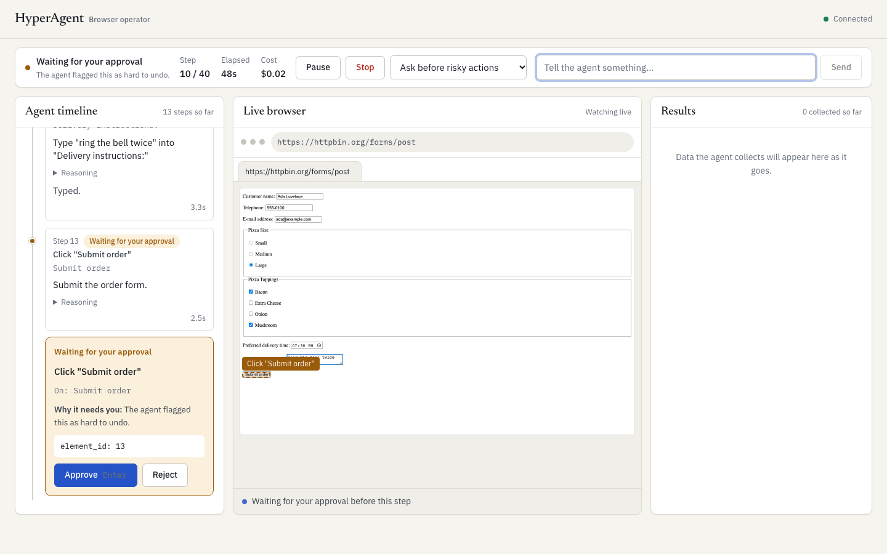

# HyperAgent

A dual-system autonomous browser agent with a transparent, steerable 2-pane operator console.

- **System 2 (Planner LLM — Claude Sonnet / Haiku / OpenRouter)** handles high-level strategy: planning, multi-step navigation, parallel multi-tab reading (`read_urls_parallel`), structured data extraction (`record_findings`), and final report synthesis (`done`).
- **System 1 ([TypeSafe Jev](https://docs.typesafe.ai/introduction) + Haiku text micro-helper)** executes delegated on-page UI subgoals (`delegate(subgoal)`). It picks an operation (`CLICK`, `TYPE_TEXT`, `SELECT`, `SCROLL_*`, `WAIT`, `SUBGOAL_DONE`, `STUCK`) and a typed target element `[id]` **without sending screenshots**. Latency varies by request. Run accounting separates model attempts from completed actions and marks unavailable costs as unknown.

Give it any natural-language goal. It drives a real Chromium browser, streams every thought and target bounding box live, pauses before irreversible actions, lets you take over or drop a visual pin on the page to steer it mid-run, and finishes with a verified summary, sortable/diffable table, and CSV/JSON/Markdown exports.



---

## Core & Product Capabilities

| Capability | How HyperAgent Works |
| --- | --- |
| **Natural-language goal & follow-ups** | Enter any plain-English goal, optional start URL, model choice, and approval policy. When a run finishes, continue on the **same open browser page** (`Continue here`) or launch a fresh browser (`New browser`). |
| **Dual-System LLM + Jev orchestration** | When Jev is configured, the Planner prefers focused groups of related UI interactions with known values and a visible stopping condition. Direct tools stay available for isolated actions, ambiguous controls and recovery requiring several decisions. Jev returns an action/skip log; the Planner checks the current page before continuing, extracting or reporting. Recovery uses fresh observations and never automatically replays mutations. Password typing always requires approval. Without Jev, the Planner uses direct tools. |
| **Token-saving Smart Vision & zero-screenshot System 1** | Live 2.5 fps JPEG frames stream directly to the operator UI over WebSocket (zero LLM tokens). Jev (`system1.py`) runs with `screenshot=False` over compact DOM element labels, and the Planner (`agent.py`) reads the same indexed element list with no screenshots by default (`AGENT_VISION=1` attaches one only after repeated errors or a click that changed nothing). `read_page`/`extract` use `reader.js`, which keeps the main content and drops nav, sidebars, cookie banners and tracking-link noise. The top telemetry bar and Final Result report show recorded usage and cost coverage; Audit JSON includes model attempts and delegation reasons. |
| **Transparent 2-pane workspace** | A persistent chat sidebar sits beside the task workspace. The left pane offers `Live Stream`, `Findings`, and `Report Only` tabs; the right pane shows the live browser, target highlights, and browser tabs. The launcher groups browser settings behind one control and keeps the goal composer central. |
| **Visual Time-Travel Scrubber** | Every step captures its browser viewport snapshot. Click any step card (or its **Inspect** pill) in `Steps` to scrub back to the exact screenshot and target highlight from that moment, then click **Back to Live** to return. |
| **Visual "Point & Steer" Pin** | Click **Pin target** in the browser toolbar (or **Alt+Click** any element on the live viewport) to drop a coordinate pin `(x, y)`. The server resolves the exact underlying DOM element `[id]` via `elementFromPoint` and attaches it to your guidance message. |
| **Human-in-the-Loop control & Takeover** | **Pause / Resume (`Esc`) / Stop** at any time; pausing or sending guidance immediately invalidates any in-flight LLM decision so stale actions never execute. **Risky action gates**: `submit`, `buy`, `book`, `delete`, `send` (detected by keyword + model/Jev `irreversible` flag) and all `password` fields wait for operator approval. **Interactive Takeover**: click, type, scroll with your mouse wheel/trackpad, or switch tabs directly on the live browser when paused or waiting for input. |
| **Persistent Login Sessions & Autofill Profile** | Save authenticated cookies/`localStorage` across runs (`.hyperagent/storage_state.json`) via **Save login** / **Use saved login session**, and configure a local **Operator Profile** (`Profile` modal) for zero-typing form autofill. |
| **Parallel Multi-Tab Research & Self-Improving Domain Memory** | `read_urls_parallel` opens and extracts up to 4 `http(s)` URLs concurrently in background tabs without stealing focus. Successful runs automatically distill concise domain workflow hints into `.hyperagent/domain_memory.json`. |
| **Clean Final Result & Run-to-Run Table Diff** | Produces a verified Markdown summary, sortable data table, one-click **Diff vs previous run** (`New` row badges + `old → new` cell diffs), verified source links, open caveats, and **Copy MD / CSV / JSON** exports—plus a **History** drawer of recent runs. |
| **Evidence beside result values** | Expand a table value's **Evidence** control (also available in single-item answers) to see its matching saved finding, source URL, recording step, time, and available step capture. Exact field/value matching avoids attaching another row's source through a shared price or substring. Missing and ambiguous matches stay explicit; unverified fields keep their warning. Captures provide step context, not independent proof, and background-page sources never borrow the active tab's capture. No additional model calls. |

---

## Architecture

```
 Operator Console (Next.js + Radix UI — apps/web)
 ┌───────────────────────────────────────────┐
 │ Top ControlBar: Status · Telemetry · Mode │
 ├────────────────────┬──────────────────────┤
 │ Left Sidebar Tabs  │ Right Live Browser   │
 │ • Steps (Timeline) │ • 2.5fps JPEG Stream │
 │ • Findings (Live)  │ • Target Box & Cursor│
 │ • Final Result     │ • Time-Travel View   │
 │                    │ • Point & Steer Pin  │
 │ Guidance Composer  │ • Direct Takeover    │
 └─────────┬──────────┴──────────▲───────────┘
           │ WebSocket /ws/agent │ JSON events + frames
           ▼                     │
 FastAPI Session & Orchestrator (hyperagent/)
 ┌──────────────────────────────────────────────────────────────┐
 │ Session (server.py): Slot Semaphore · Storage State · Memory │
 │   │                                                          │
 │   ▼                                                          │
 │ Agent Loop (agent.py): Observe → Decide → Approve → Execute  │
 │   ├─► System 2 Planner (llm.py): Strategy, Read, Extract     │
 │   └─► System 1 Fast Loop (system1.py + fast.py):             │
 │         ├─ TypeSafe Jev: 1 request → Op + Speculative Target │
 │         └─ Claude Haiku: Micro-prompt text value (TYPE_TEXT) │
 │   │                                                          │
 │   ▼                                                          │
 │ BrowserSession (browser.py + dom.js):                        │
 │   Playwright Chromium · Reading-Order DOM Walker [id]        │
 │   Smart Inner-Container Scroll · Parallel Tab Reader · SSRF  │
 └──────────────────────────────────────────────────────────────┘
```

### Key Engineering Decisions

1. **Reading-Order DOM Indexing Instead of Raw HTML (`hyperagent/dom.js`, `hyperagent/browser.py`)**
   - Raw HTML wastes tens of thousands of tokens. Our DOM walker serializes visible text in reading order with interactive controls inline as `[12]<button>Find Flights</button>` and records each element's pixel bounding box (`rect`).
   - Models only emit integer `element_id`s from the latest observation—never brittle CSS/XPath selectors or arbitrary JS. Stale IDs fail loudly instead of clicking the wrong control.

2. **Speculative Multi-Head System 1 (`hyperagent/fast.py`, `hyperagent/system1.py`)**
   - Each Jev call sends one multi-question request: an operation head (`CLICK`, `TYPE_TEXT`, `SELECT`, `SCROLL_*`, `WAIT`, `SUBGOAL_DONE`, `STUCK`), speculative per-operation target heads (each offering only compatible elements), and an `irreversible` risk head.
   - Only the chosen operation's target head is consumed, and probability distributions are strictly validated before execution.

3. **Zero Silent Failures & Guaranteed Terminal Result (`hyperagent/agent.py`)**
   - Browser mutations (`click`, `type_text`, `select_option`) are **never** auto-retried; only transient LLM transport errors are retried with visible notices.
   - SHA-1 page-state hashing (`_mark_no_change`), action-signature loop warnings (`_loop_warnings`), and CAPTCHA/bot-wall detection (`_page_warnings`) prevent blind repetition.
   - After every click, selection or key press the browser waits for the DOM to stop changing (≤1.5 s) before the next observation, so menus, dialogs and date pickers that animate in are seen rather than re-clicked. `navigate` refuses to reload the page it is already on, since a reload discards everything entered so far.
   - The planner always sees element ids and always has every tool; with Jev configured it additionally gets `delegate`. Nothing is gated behind "recovery turns", so a single confirmation click never has to be improvised with another tool.
   - Every run—even if stopped early or out of steps/budget—synthesizes an honest partial `result` from saved `findings`.

---

## Verified Runs

For independently graded browser tasks, see [the evaluation suite](docs/evals/README.md). Its first two cases
check prefilled forms and committed autocomplete selections using actual browser state. Offline tests validate the graders;
paid live trials are separate and explicit. The older stress runs below use agent-reported success plus
manual review, not this independent grader.

The latest [submission verification](docs/runs/submission-2026-10-18/README.md) records live fixture trials,
a real frontend-to-backend catalogue task, source checks, and report persistence after refresh.
Those historical totals cover planner/extraction calls only. New runs record planner, extraction, Jev, and text-helper attempts, including retries and invalid responses. Available provider usage is retained; native-model dollar estimates use configured rates, while Jev dollar cost remains unknown. The UI labels partial costs and no longer estimates token savings from call counts. Existing cost limits still apply to the legacy planner/extraction subtotal between planner steps, not total provider spend.

**Stress test on 18 unseen goals** ([details and raw logs](docs/runs/stress-test/README.md)): research, tables, docs lookups, forms, logins, prices, flights, news, and pagination. On Claude Sonnet as planner, 16 of 18 complete end-to-end in 13–60 s; the remaining two end with an explicit partial report when blocked by a bot wall or insufficient upstream results.

**Dual system** (Planner + TypeSafe Jev):

| Task | Planner calls | Jev calls | Time | Planner cost | Outcome |
| --- | --- | --- | --- | --- | --- |
| Fill and submit the httpbin pizza order form, report what the server received | 6 | 7 (avg 434 ms) | 32 s | $0.0019 | Planner delegated phone, email, size, toppings, and delivery time to Jev (6 actions at 96–100% confidence), then requested operator approval on `"Submit order"`. |
| Delegate only (no planner): choose Large and tick Bacon and Mushroom | 0 | 4 | 3.4 s | n/a | 3 clicks plus `SUBGOAL_DONE` at 95–100% confidence; page state verified afterwards. |

---

## Run Locally

Requires Python 3.12+, [uv](https://docs.astral.sh/uv/), and Node 22+.

```bash
uv sync
uv run playwright install chromium
cp .env.example .env          # set TYPESAFE_API_KEY (System 1) and ANTHROPIC_API_KEY / LLM_API_KEY
cd apps/web && npm ci && npm run build && cd ../..
uv run --env-file .env hyperagent-server
```

Open **http://localhost:8766** (or set `PORT=8790` to run on another port).
- For frontend hot-reload during development: run `npm run dev` in `apps/web` (port 3000; connects to the backend on 8766).
- For offline UI testing without spending API credits: run `npm run mock` and `npm run dev:mock` in `apps/web`.
- CLI headless smoke runner:
  ```bash
  uv run --env-file .env python tools/run_task.py "On books.toscrape.com, list the Travel books with prices" --out run.json
  ```

---

## Deploy

The `Dockerfile` builds the Next.js static export and serves both the console and `/ws/agent` WebSocket from a single container with headless Chromium included:

```bash
docker build -t hyperagent .
docker run --rm --init --shm-size=1g -p 8766:8766 --env-file .env hyperagent
```

- **Railway** (`railway.json` included): `railway up`, set `TYPESAFE_API_KEY` and `ANTHROPIC_API_KEY` (or `LLM_API_KEY`), and generate a public domain.
- **Fly.io / Render**: deploy the `Dockerfile` with at least 1 GB RAM.
- **Hosted Browser (Browserbase / Steel / Browserless)**: set `BROWSER_WS_URL` to your remote CDP endpoint.

---

## Repository Layout & Checks

```
hyperagent/   agent.py (planner loop + controls + smart vision) · system1.py (Jev fast loop)
              fast.py (TypeSafe Jev + Haiku text helper) · browser.py (Playwright + parallel tabs + pin)
              dom.js (reading-order DOM walker) · llm.py · tools.py · prompts.py · server.py
apps/web/     Next.js 15 console: AgentApp, Launcher, ControlBar, Timeline, StepCard,
              BrowserView, ApprovalCard, ResultsPanel, ResultReport, DataTable, OperatorModals
docs/         protocol.md (WebSocket contract) · runs/ (verified run logs & stress tests)
tests/        offline unit, agent, System 1, console, and real-Chromium eval tests
tools/        run_task.py live CLI runner · evals/ independent browser outcome graders
```

Run the full verification suite (no paid API calls):

```bash
uv run ruff check . && uv run pytest
cd apps/web && npm run lint && npm run typecheck && npm run build
```
